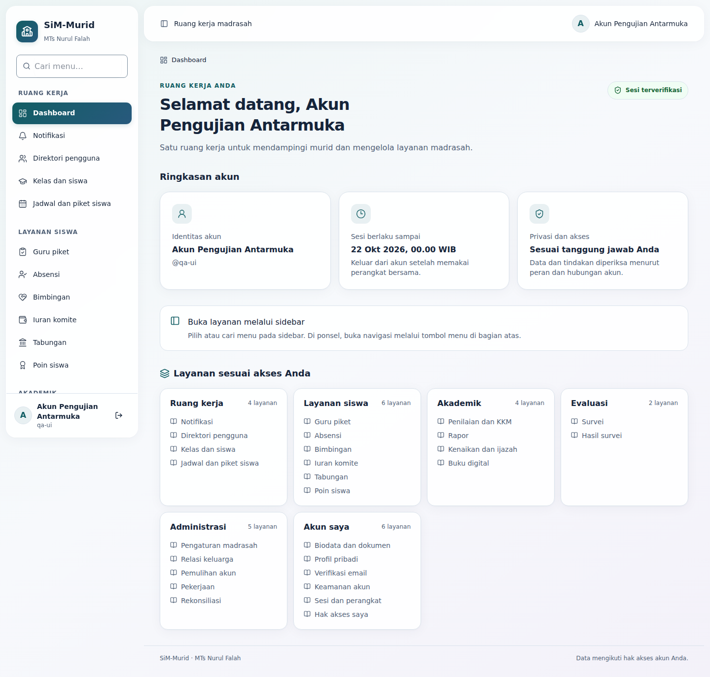
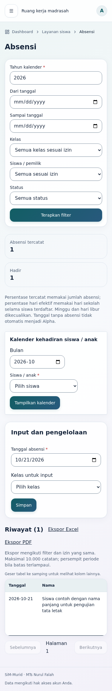

# Adaptasi plass-ui dan navigasi sidebar

Tanggal:21 Oktober2026 (Asia/Jakarta). Target: `kamadmtsnf-ai/sim-murid/rebuilt`. Baseline main:`72069b8255665401cf226e99c814fb2a05143285`. Branch:`design/plass-ui-sidebar-navigation`.

## Hasil

Antarmuka mengadaptasi material plass-ui: panel kaca netral, gradasi135° teal-ke-biru pada kontrol, bayangan ringan, sidebar berbingkai dengan ikon layanan dan background wash lembut. Dashboard menjadi ringkasan akun dan daftar layanan noninteraktif. Primary teal#125e64 tetap, endpoint#28597d; komponen Radix/shadcn/Tailwind/Lucide existing dipakai tanpa dependensi runtime tambahan.

Navigasi modul kini dipusatkan pada sidebar.34 tautan statis yang menduplikasi tujuan sidebar dihapus dari20 file halaman/panel. Selain itu kartu pintasan dashboard, tiga bar navigasi modul, tautan avatar topbar dan tautan breadcrumb dilepas. Breadcrumb tetap menjadi penunjuk lokasi berupa teks. Komponen ModuleNavigation yang tidak lagi dipakai dihapus bersama import dan style-nya. Search menu, active state, drawer ponsel, keyboard/focus serta logout sidebar tetap bekerja.

Tombol simpan, filter, ekspor, dialog, validasi dokumen, refresh dan perpindahan bagian formulir tetap ada karena merupakan tindakan. Tautan detail rekaman, pagination, pratinjau/unduhan dan login/pemulihan publik dipertahankan: tujuan tersebut tidak digantikan sidebar. Onboarding biodata/email sekarang mengarahkan pengguna melalui keterangan nama menu sidebar. Redirect autentikasi dan pengiriman formulir tidak diubah.

## Referensi yang benar-benar dibaca

[jooy2/plass-ui](https://github.com/jooy2/plass-ui/tree/7f7a86c39931ca7b58d55c8c0f70897ea9359c7e) dipin pada SHA7f7a86c39931ca7b58d55c8c0f70897ea9359c7e. Sumber: README, docs/en/design/design-language.md, color.md, docs/.vitepress/demos/examples/dashboard.tsx, packages/react/src/components/sidebar/PlSidebar.tsx, button/PlButton.tsx, card/PlCard.tsx, internal/styles.ts, styles.css dan LICENSE. Lisensi MIT disimpan pada docs/licenses/plass-ui-LICENSE.txt.

| Pola referensi | Adaptasi SiM-Murid | Alasan |
|---|---|---|
| Kontrol bergradasi135°, kontainer kaca netral |Kontrol teal-biru; panel netral opacity0,88|Brand tetap dan teks data lebih mudah dibaca|
| Sidebar menjadi drawer di layar kecil |Sidebar desktop mengambang; drawer Radix existing|Navigasi satu tempat dengan fokus yang sudah teruji|
| Satu skala tinggi/radius/transition |Token bersama; input/default button44px; gerak150/200ms|Konsistensi dan touch target|
| Pointer-follow bloom dan blur kuat |Tidak menambahkan pointer bloom; blur hanya sidebar/topbar|Menghindari listener pointer dan biaya blur di setiap baris/kartu|
| Background terstruktur |Wash lembut mengikuti scroll|Kontinuitas halaman panjang dan perilaku ponsel|
| Reduced transparency dan focus management |Fallback opaque, reduced motion, forced-colors; fokus Radix tetap|Aksesibilitas tidak bergantung efek visual|
| Contoh dashboard toko |Tidak menyalin data, grafik atau KPI contoh|Dashboard hanya menampilkan identitas, sesi dan metadata akses yang tersedia|

Master design system existing diperbarui, bukan membuat design system kedua: [MASTER.md](../design-system/MASTER.md).

## Pengujian aktual

- `npm ci`:579 paket. Package/lockfile/dependensi runtime tidak berubah.
- `npm run check`:159 tes, typecheck, lint, drift tipe dan production build lulus setelah cache dibersihkan. Termasuk5 tes UI:menu/capability, deep link, kontras, deteksi navigasi duplikat dan kedua ujung gradasi. Rangkaian domain mencakup integrasi lokal PGlite; tidak diklaim sebagai uji mutasi produksi.
- Audit statis:60 TSX,103 kontrol,0 hubungan label yang tidak terselesaikan.
- Browser final Chromium149/Playwright:54 pemeriksaan lulus.360,375,768,1024,1440px; dialog812×375 landscape dan teks200%. Tidak ada overflow dokumen pada skenario yang diuji.
- Dashboard tidak memiliki link/tombol pintasan. Panel operasi/akademik/layanan tidak mempunyai link modul `/account`. Sidebar search/empty/reset, touch drawer, Escape/focus restore dan keyboard untuk menu bawah diperiksa.
- Form kelas:required validation, focus trap, draft yang tidak dibuang ketika pembatalan ditolak, payload existing dan state sukses. Login:toggle password, pending, error/fokus dan pemertahanan nilai. Respons mutasi kelas/login diintersep pada fixture agar tidak menulis data nyata.
- API lokal asli:akses anonim401 dan foreign-origin403; konfigurasi publik Supabase diberikan hanya pada child process QA, tanpa secret administratif.
- axe-core:0 pelanggaran pada7 tampilan yang diuji; tidak mengklaim sertifikasi WCAG keseluruhan.
- Lint/build dan browser dijalankan ulang sesudah penyesuaian background scroll dan tambahan pemeriksaan keyboard. Screenshot desktop/ponsel ditinjau langsung.
- Perbandingan blob sumber menunjukkan tidak ada perubahan backend/API/auth/proxy/database/lockfile. Satu penghapusan adalah helper navigasi visual yang tidak dipakai; tidak ada migrasi yang dihapus.

Bukti: [check.log](plass/check.log), [release-build.log](plass/release-build.log), [release-lint.log](plass/release-lint.log), [browser-results.json](plass/browser-results.json), [label-audit.json](plass/label-audit.json), [source-boundaries.json](plass/source-boundaries.json), [removed-links.json](plass/removed-links.json).

Build pertama gagal membaca cache Turbopack lokal (`static_sorted_file` slice out-of-range). Direktori hasil build `.next` dibersihkan, lalu check lengkap dan build berikutnya lulus. Cache ini tidak menjadi bagian commit dan konfigurasi build aplikasi tidak diganti.

## Batas bukti

Halaman publik diuji pada production build lokal; layar akun memakai fixture komponen terisolasi di tests/ui, bukan login palsu pada aplikasi. Belum ada UAT browser seluruh role dengan akun nyata, perangkat fisik/pembaca layar atau benchmark GPU/Core Web Vitals. Tidak menjalankan provider, migrasi, cutover atau perubahan akun produksi. Reduced-transparency/forced-colors disediakan pada CSS; cakupan browser otomatis utama adalah light mode/reduced motion, sehingga tidak mengklaim seluruh mode aksesibilitas teruji perangkat.

Environment Preview pada rilis sebelumnya belum mempunyai konfigurasi publik Supabase lengkap; perubahan UI ini tidak mengubah environment atau menyalin secret produksi. Kesiapan platform preview tidak boleh dianggap sebagai lulusnya UAT backend. Main/produksi tidak diganti oleh pembuatan branch ini.

Menjalankan ulang browser menggunakan skrip yang sama dengan output terpisah:

```bash
UI_QA_OUTPUT=docs/verification/plass \
UI_TEST_TOOLS=/tmp/plass-browser-tools/node_modules \
UI_CHROMIUM_EXECUTABLE=/tmp/plass-chromium/chromium \
UI_QA_ENV_FILE=/tmp/plass-public-env.json \
npm run test:ui:browser
```

Tools QA sementara:esbuild0.25.12,axe-core4.11.0,Chromium149.0.0; Playwright dari runtime. File konfigurasi QA hanya berisi dua environment publik dan tidak di-commit. Penyesuaian script tidak menambahkan route fixture ke aplikasi.

## Screenshot




## Peta perubahan file

|File|Alasan|
|---|---|
|`README.md`|Indeks laporan pembaruan dan jumlah tes.|
|`docs/design-system/MASTER.md`|Referensi, keputusan desain, lisensi atau bukti verifikasi.|
|`docs/licenses/plass-ui-LICENSE.txt`|Referensi, keputusan desain, lisensi atau bukti verifikasi.|
|`docs/ui-provenance.md`|Referensi, keputusan desain, lisensi atau bukti verifikasi.|
|`docs/verification/plass-ui.md`|Referensi, keputusan desain, lisensi atau bukti verifikasi.|
|`docs/verification/plass/browser-results.json`|Referensi, keputusan desain, lisensi atau bukti verifikasi.|
|`docs/verification/plass/browser.log`|Referensi, keputusan desain, lisensi atau bukti verifikasi.|
|`docs/verification/plass/check.log`|Referensi, keputusan desain, lisensi atau bukti verifikasi.|
|`docs/verification/plass/dashboard-1440.png`|Referensi, keputusan desain, lisensi atau bukti verifikasi.|
|`docs/verification/plass/initial-build-cache-failure.log`|Referensi, keputusan desain, lisensi atau bukti verifikasi.|
|`docs/verification/plass/label-audit.json`|Referensi, keputusan desain, lisensi atau bukti verifikasi.|
|`docs/verification/plass/local-server.log`|Referensi, keputusan desain, lisensi atau bukti verifikasi.|
|`docs/verification/plass/npm-ci.log`|Referensi, keputusan desain, lisensi atau bukti verifikasi.|
|`docs/verification/plass/operations-375.png`|Referensi, keputusan desain, lisensi atau bukti verifikasi.|
|`docs/verification/plass/release-build.log`|Referensi, keputusan desain, lisensi atau bukti verifikasi.|
|`docs/verification/plass/release-lint.log`|Referensi, keputusan desain, lisensi atau bukti verifikasi.|
|`docs/verification/plass/removed-links.json`|Referensi, keputusan desain, lisensi atau bukti verifikasi.|
|`docs/verification/plass/source-boundaries.json`|Referensi, keputusan desain, lisensi atau bukti verifikasi.|
|`scripts/verify-ui.mjs`|Tes atau QA untuk navigasi terpusat, visual dan aksesibilitas.|
|`src/app/account/access/page.tsx`|Lepas navigasi duplikat; petunjuk sidebar untuk onboarding; tindakan bisnis tetap.|
|`src/app/account/biodata/[id]/page.tsx`|Lepas navigasi duplikat; petunjuk sidebar untuk onboarding; tindakan bisnis tetap.|
|`src/app/account/biodata/biodata-panel.tsx`|Lepas navigasi duplikat; petunjuk sidebar untuk onboarding; tindakan bisnis tetap.|
|`src/app/account/biodata/page.tsx`|Lepas navigasi duplikat; petunjuk sidebar untuk onboarding; tindakan bisnis tetap.|
|`src/app/account/classes/page.tsx`|Lepas navigasi duplikat; petunjuk sidebar untuk onboarding; tindakan bisnis tetap.|
|`src/app/account/directory/[id]/page.tsx`|Lepas navigasi duplikat; petunjuk sidebar untuk onboarding; tindakan bisnis tetap.|
|`src/app/account/directory/page.tsx`|Lepas navigasi duplikat; petunjuk sidebar untuk onboarding; tindakan bisnis tetap.|
|`src/app/account/email/email-panel.tsx`|Lepas navigasi duplikat; petunjuk sidebar untuk onboarding; tindakan bisnis tetap.|
|`src/app/account/email/page.tsx`|Lepas navigasi duplikat; petunjuk sidebar untuk onboarding; tindakan bisnis tetap.|
|`src/app/account/error.tsx`|Lepas navigasi duplikat; petunjuk sidebar untuk onboarding; tindakan bisnis tetap.|
|`src/app/account/families/page.tsx`|Lepas navigasi duplikat; petunjuk sidebar untuk onboarding; tindakan bisnis tetap.|
|`src/app/account/learning/[module]/page.tsx`|Lepas navigasi duplikat; petunjuk sidebar untuk onboarding; tindakan bisnis tetap.|
|`src/app/account/learning/[module]/panel.tsx`|Lepas navigasi duplikat; petunjuk sidebar untuk onboarding; tindakan bisnis tetap.|
|`src/app/account/operations/[module]/page.tsx`|Lepas navigasi duplikat; petunjuk sidebar untuk onboarding; tindakan bisnis tetap.|
|`src/app/account/operations/[module]/panel.tsx`|Lepas navigasi duplikat; petunjuk sidebar untuk onboarding; tindakan bisnis tetap.|
|`src/app/account/profile/page.tsx`|Lepas navigasi duplikat; petunjuk sidebar untuk onboarding; tindakan bisnis tetap.|
|`src/app/account/recovery/page.tsx`|Lepas navigasi duplikat; petunjuk sidebar untuk onboarding; tindakan bisnis tetap.|
|`src/app/account/schedules/page.tsx`|Lepas navigasi duplikat; petunjuk sidebar untuk onboarding; tindakan bisnis tetap.|
|`src/app/account/security/security-panel.tsx`|Lepas navigasi duplikat; petunjuk sidebar untuk onboarding; tindakan bisnis tetap.|
|`src/app/account/services/[module]/page.tsx`|Lepas navigasi duplikat; petunjuk sidebar untuk onboarding; tindakan bisnis tetap.|
|`src/app/account/services/[module]/panel.tsx`|Lepas navigasi duplikat; petunjuk sidebar untuk onboarding; tindakan bisnis tetap.|
|`src/app/account/sessions/session-panel.tsx`|Lepas navigasi duplikat; petunjuk sidebar untuk onboarding; tindakan bisnis tetap.|
|`src/app/account/settings/page.tsx`|Lepas navigasi duplikat; petunjuk sidebar untuk onboarding; tindakan bisnis tetap.|
|`src/app/globals.css`|Token gradasi, wash, material kaca, fallback aksesibilitas dan layout adaptif.|
|`src/components/account-dashboard.tsx`|Ganti kartu pintasan menjadi ringkasan noninteraktif.|
|`src/components/navigation-icon.tsx`|Ikon Lucide konsisten per tujuan sidebar.|
|`src/components/ui/button.tsx`|Material kontrol/kartu bersama; kontrak komponen tetap.|
|`src/components/ui/card.tsx`|Material kontrol/kartu bersama; kontrak komponen tetap.|
|`src/components/workspace-shell.tsx`|Ikon menu; lepas avatar-link dan breadcrumb-link di luar sidebar.|
|`tests/ui.test.ts`|Tes atau QA untuk navigasi terpusat, visual dan aksesibilitas.|
|`src/components/module-navigation.tsx`|Hapus helper navigasi yang tidak dipakai lagi.|
