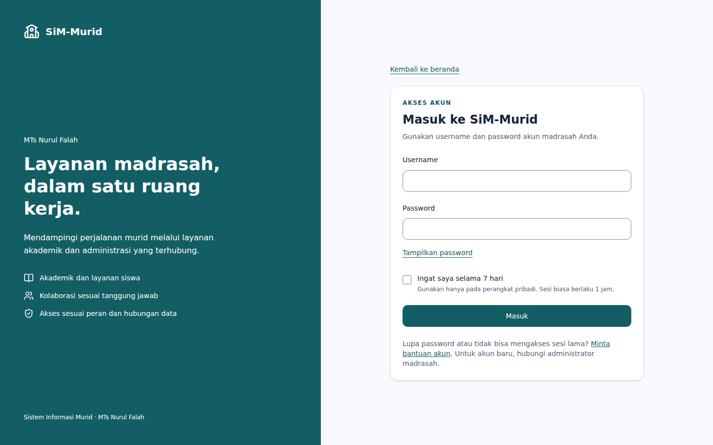
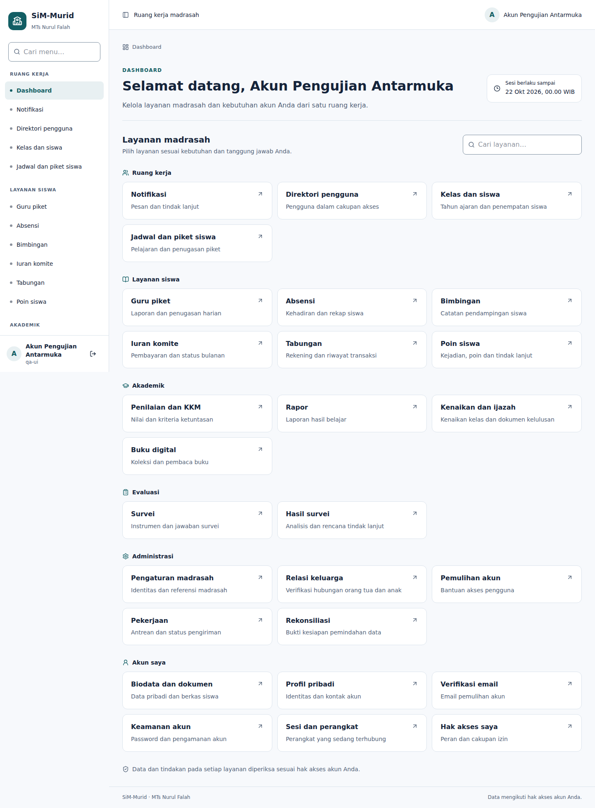
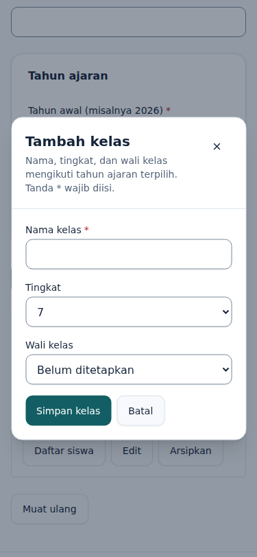

# Audit dan verifikasi UI/UX enterprise — Rebuilt SiM-Murid

Tanggal:21 Oktober2026 (Asia/Jakarta). Target `kamadmtsnf-ai/sim-murid/rebuilt`, baseline `55fa7add212437df33808dd8fa97926e740c72db`, branch `design/enterprise-ux-20261021`. Identitas target SiM-Murid dipertahankan meskipun judul prompt menyebut SiM-Guru.

## Hasil dan dampak

Kerangka akun bersama kini menyediakan sidebar desktop, drawer seluler, topbar, breadcrumb, pencarian menu dan active state. Dashboard mengelompokkan layanan nyata tanpa angka/KPI buatan. Menu mengambil capability dari context server dan menyembunyikan tautan khusus Admin bagi non-Admin; otorisasi tetap pada page/API/RPC existing. Context shell tidak menggantikan gate keamanan atau survei wajib.

Login mendapat layout adaptif, hierarki heading yang benar, feedback pending/error, fokus ke pesan gagal dan nilai input yang tetap tersimpan. Kontrak username/password/remember tetap sama. Form kelas pendek memakai dialog Radix, fokus terperangkap dan kembali ke pembuka, tombol tutup/Escape serta konfirmasi draft belum tersimpan. Survei, transaksi, keamanan dan alur kompleks tetap berupa halaman. Native confirmation bisnis existing dipertahankan.

Tabel mendapat caption/scope kolom, region gulir yang dapat difokus keyboard, header tak terpecah, angka tabular dan petunjuk gulir di ponsel. Kolom dan data bisnis tetap ada; tinggi maksimum daftar status bulanan dipertahankan. Label kelas tujuan pada pratinjau kenaikan ditambahkan setelah audit menemukan label yang hilang. Token/control bersama memperbaiki konsistensi lintas halaman; loading dan error boundary akun ditambahkan.

| Ukuran | Sebelum | Setelah / bukti |
|---|---|---|
| Kerangka navigasi akun bersama | Tidak ada account layout | Satu layout untuk seluruh route akun |
| Navigasi panel operasi/akademik/layanan |3 implementasi berulang|1 ModuleNavigation reusable|
| Tinggi default tombol |36px|44px; input terukur minimal44px di browser|
| Kontras batas input/putih |1,30:1|3,42:1|
| Kontras teks primary/putih |7,47:1|Dipertahankan7,47:1|
| Teks metadata/putih |6,22:1|Dipertahankan6,22:1|
| Kontrol JSX tanpa asosiasi label yang terdeteksi |1|0 dari104 kontrol dalam60 TSX (audit statis)|
| Overflow halaman pada viewport uji |Baseline tidak diukur browser|0 pada360,375,768,1024,1440px dalam skenario yang diuji|
| Pelanggaran axe |Baseline tidak diukur|0 pada7 tampilan yang diuji; bukan sertifikasi WCAG|

Master design system: [MASTER.md](../design-system/MASTER.md). Hasil generator dan semua query aktual: [recommendations.md](../design-system/recommendations.md). Hasil yang tidak cocok ditolak dan dicatat, termasuk pattern pemasaran, pergantian API ke Server Actions, serta query ikon tanpa hasil. daisyUI tidak diinstal; Lucide/shadcn/Radix/Tailwind existing dipertahankan.

## Pengujian yang benar-benar dijalankan

- `npm ci`:579 paket terpasang; lockfile dan versi dependensi aplikasi tetap sama.
- `npm run check`:typecheck, lint,157 tes, drift tipe database dan production build lulus. Rangkaian mencakup unit serta integrasi lokal PGlite untuk autentikasi, sesi, izin, pendidikan, operasi, pembelajaran dan layanan. Setelah koreksi fokus dialog, label dan presentasi tabel, typecheck/lint/build dijalankan ulang; hasil akhir dicatat terpisah.
- `node scripts/audit-ui.mjs`:60 TSX,104 kontrol,0 asosiasi label yang tidak terselesaikan secara struktural.
- Browser Chromium149 melalui Playwright:49 pemeriksaan lulus. Viewport360/375/768/1024/1440; tambahan dialog812×375 landscape dan teks dashboard200%. Pencarian, empty/reset, touch drawer, Escape/focus restore, focus trap dialog, required validation, draft/discard, sukses penyimpanan, login pending/error/fokus/nilai, tabel keyboard/scroll dan reduced motion diperiksa.
- axe-core:7 tampilan—dashboard desktop, drawer seluler, dialog kelas, panel operasi, akademik, layanan dan halaman login lokal—tanpa pelanggaran yang dilaporkan pada rule set yang dijalankan.
- Kontrak kirim kelas dan login diverifikasi dengan respons API yang diintersep pada fixture. API lokal asli juga menolak akses anonim401 serta mutasi foreign-origin403.
- Tidak ada error browser tak tertangani pada eksekusi akhir. Screenshot login desktop/ponsel, dashboard desktop, dialog kelas ponsel dan tabel operasi ponsel ditinjau secara visual; masalah header/kolom tabel dari iterasi awal diperbaiki.
- Perbandingan SHA blob terhadap baseline:tidak ada perubahan pada `src/lib`, `src/app/api`, `supabase`, `src/proxy.ts`, `next.config.ts` atau lockfile; tidak ada file baseline yang hilang. Gate akun pada dashboard dipertahankan.

Log: [check.log](ui/check.log), [release-types.log](ui/release-types.log), [release-lint.log](ui/release-lint.log), [release-build.log](ui/release-build.log), [browser-results.json](ui/browser-results.json), [label-audit.json](ui/label-audit.json), [source-boundaries.json](ui/source-boundaries.json). Inventaris sumber: [ui-source-inventory.json](ui-source-inventory.json).

## Batas bukti dan risiko

Halaman publik diuji pada build Next.js lokal yang sebenarnya. Layar akun memakai fixture komponen dengan data contoh, bukan sesi login palsu untuk aplikasi. Fixture hanya di `tests/ui`, dibundel/di-host sementara oleh skrip QA dan tidak menjadi route aplikasi. Respons login/penyimpanan diintersep untuk menguji kontrak serta state; keberhasilan tersebut bukan bukti login atau mutasi produksi. Tidak ada database migration, impor data, pengiriman provider, atau perubahan akun produksi.

UAT browser dengan akun nyata untuk seluruh role, seluruh modal/domain, dokumen/ekspor produksi, pembaca layar fisik, perangkat iOS/Android nyata, dan metrik Core Web Vitals lapangan belum dijalankan. Regresi RBAC lokal dan penyaringan capability tidak menggantikan UAT tersebut. Shell menambah pembacaan principal/context; belum ada benchmark latensi autentikasi dengan pengguna produksi. Jika pembacaan context gagal, menu minimum akun tetap tersedia dan page tetap menjalankan pemeriksaan existing. Dark mode tidak ditambahkan dan tidak diklaim teruji.

## Kendala yang diselesaikan

Unduhan browser standar Playwright gagal berupa arsip kosong/rusak. Alternatif Chromium149 dari paket `@sparticuz/chromium` dipakai hanya dalam direktori QA sementara; dependensi runtime aplikasi tidak berubah. Ekstraksi arsip font melalui helper awal tidak cocok dengan izin owner container; arsip diekstrak tanpa perubahan owner dan binary berjalan. Fixture bundler awal memerlukan definisi environment browser; adapter terisolasi diperbaiki. Penutupan drawer awal tidak memulihkan fokus ke pemicu eksternal; handler close Radix memakai referensi pemicu dan uji ulang lulus. Uji login dibetulkan agar menunggu perpindahan fokus serta membedakan pesan aplikasi dari route announcer Next.js.

API anonim lokal mula-mula500 karena environment publik Supabase belum ada. Konfigurasi publik proyek digunakan untuk child process QA, tanpa secret administratif atau penyalinan kredensial ke git; uji ulang401/403 lulus. Ini tidak mengubah environment hosting.

## Menjalankan ulang

```bash
npm ci
npm run check
node scripts/audit-ui.mjs
```

Untuk browser, sediakan Playwright+Chromium, esbuild dan axe-core di lingkungan QA. Skrip menerima `UI_TEST_TOOLS` (direktori node_modules esbuild/axe), `UI_CHROMIUM_EXECUTABLE` (opsional), dan `UI_QA_ENV_FILE` berisi hanya konfigurasi publik Supabase. Port lokal3088 dan3090 harus kosong. Paket QA tidak dipasang sebagai dependensi aplikasi. Eksekusi sesi ini memakai esbuild0.25.12,axe-core4.11.0 dan Chromium149.0.0.

```bash
UI_TEST_TOOLS=/tmp/ui-browser-tools/node_modules \
UI_CHROMIUM_EXECUTABLE=/tmp/ui-chromium-bin/chromium \
UI_QA_ENV_FILE=/tmp/ui-public-env.json \
npm run test:ui:browser
```

## Screenshot pilihan





## Peta file dan alasan perubahan

| File | Alasan |
|---|---|
|`README.md`|Indeks design system dan perintah verifikasi.|
|`docs/design-system/MASTER.md`|Keputusan desain, provenance, audit atau bukti pengujian aktual.|
|`docs/design-system/recommendations.md`|Keputusan desain, provenance, audit atau bukti pengujian aktual.|
|`docs/licenses/ui-ux-pro-max-LICENSE.txt`|Keputusan desain, provenance, audit atau bukti pengujian aktual.|
|`docs/ui-provenance.md`|Keputusan desain, provenance, audit atau bukti pengujian aktual.|
|`docs/verification/ui-source-inventory.json`|Keputusan desain, provenance, audit atau bukti pengujian aktual.|
|`docs/verification/ui-ux-enterprise.md`|Keputusan desain, provenance, audit atau bukti pengujian aktual.|
|`docs/verification/ui/browser-results.json`|Keputusan desain, provenance, audit atau bukti pengujian aktual.|
|`docs/verification/ui/browser.log`|Keputusan desain, provenance, audit atau bukti pengujian aktual.|
|`docs/verification/ui/check.log`|Keputusan desain, provenance, audit atau bukti pengujian aktual.|
|`docs/verification/ui/class-dialog-375.png`|Keputusan desain, provenance, audit atau bukti pengujian aktual.|
|`docs/verification/ui/dashboard-1440.png`|Keputusan desain, provenance, audit atau bukti pengujian aktual.|
|`docs/verification/ui/label-audit.json`|Keputusan desain, provenance, audit atau bukti pengujian aktual.|
|`docs/verification/ui/local-server.log`|Keputusan desain, provenance, audit atau bukti pengujian aktual.|
|`docs/verification/ui/login-1440.png`|Keputusan desain, provenance, audit atau bukti pengujian aktual.|
|`docs/verification/ui/login-375.png`|Keputusan desain, provenance, audit atau bukti pengujian aktual.|
|`docs/verification/ui/npm-ci.log`|Keputusan desain, provenance, audit atau bukti pengujian aktual.|
|`docs/verification/ui/operations-375.png`|Keputusan desain, provenance, audit atau bukti pengujian aktual.|
|`docs/verification/ui/release-build.log`|Keputusan desain, provenance, audit atau bukti pengujian aktual.|
|`docs/verification/ui/release-lint.log`|Keputusan desain, provenance, audit atau bukti pengujian aktual.|
|`docs/verification/ui/release-types.log`|Keputusan desain, provenance, audit atau bukti pengujian aktual.|
|`docs/verification/ui/source-boundaries.json`|Keputusan desain, provenance, audit atau bukti pengujian aktual.|
|`package.json`|Perintah QA UI dan penambahan tes UI ke check; dependensi tetap.|
|`scripts/audit-ui.mjs`|Fixture terisolasi, audit label, tes menu/kontras atau browser QA.|
|`scripts/verify-ui.mjs`|Fixture terisolasi, audit label, tes menu/kontras atau browser QA.|
|`src/app/account/classes/class-panel.tsx`|Dialog form pendek, fokus pembuka, perlindungan draft dan status busy.|
|`src/app/account/directory/directory-panel.tsx`|Navigasi atau tabel reusable; data, validasi dan tindakan dipertahankan.|
|`src/app/account/error.tsx`|Pemulihan error route tanpa rincian internal.|
|`src/app/account/layout.tsx`|Shell akun dan menu dari principal/capability existing.|
|`src/app/account/learning/[module]/panel.tsx`|Navigasi/tabel reusable dan label pilihan kelas tujuan.|
|`src/app/account/loading.tsx`|Status pemuatan dan skeleton route akun.|
|`src/app/account/operations/[module]/panel.tsx`|Navigasi atau tabel reusable; data, validasi dan tindakan dipertahankan.|
|`src/app/account/page.tsx`|Dashboard berkelompok; gate autentikasi/keamanan/survei tetap.|
|`src/app/account/schedules/schedule-panel.tsx`|Navigasi atau tabel reusable; data, validasi dan tindakan dipertahankan.|
|`src/app/account/services/[module]/insights.tsx`|Navigasi atau tabel reusable; data, validasi dan tindakan dipertahankan.|
|`src/app/account/services/[module]/panel.tsx`|Navigasi atau tabel reusable; data, validasi dan tindakan dipertahankan.|
|`src/app/account/settings/settings-panel.tsx`|Navigasi atau tabel reusable; data, validasi dan tindakan dipertahankan.|
|`src/app/globals.css`|Token semantik, responsivitas, focus, ukuran sentuh, tabel dan reduced motion.|
|`src/app/login/login-form.tsx`|Layout login, feedback, focus error, password toggle; payload tetap.|
|`src/app/login/page.tsx`|Layout login, feedback, focus error, password toggle; payload tetap.|
|`src/app/recovery/email/page.tsx`|Permukaan dan jarak halaman bantuan akun yang konsisten.|
|`src/app/recovery/page.tsx`|Permukaan dan jarak halaman bantuan akun yang konsisten.|
|`src/components/account-dashboard.tsx`|Komponen atau konfigurasi bersama untuk konsistensi presentasi.|
|`src/components/domain-controls.tsx`|Komponen atau konfigurasi bersama untuk konsistensi presentasi.|
|`src/components/module-navigation.tsx`|Komponen atau konfigurasi bersama untuk konsistensi presentasi.|
|`src/components/ui/badge.tsx`|Komponen atau konfigurasi bersama untuk konsistensi presentasi.|
|`src/components/ui/button.tsx`|Komponen atau konfigurasi bersama untuk konsistensi presentasi.|
|`src/components/ui/data-table.tsx`|Komponen atau konfigurasi bersama untuk konsistensi presentasi.|
|`src/components/ui/dialog.tsx`|Komponen atau konfigurasi bersama untuk konsistensi presentasi.|
|`src/components/ui/status.tsx`|Komponen atau konfigurasi bersama untuk konsistensi presentasi.|
|`src/components/workspace-shell.tsx`|Komponen atau konfigurasi bersama untuk konsistensi presentasi.|
|`src/config/account-navigation.ts`|Komponen atau konfigurasi bersama untuk konsistensi presentasi.|
|`tests/ui.test.ts`|Fixture terisolasi, audit label, tes menu/kontras atau browser QA.|
|`tests/ui/fixture.tsx`|Fixture terisolasi, audit label, tes menu/kontras atau browser QA.|
|`tests/ui/navigation-shim.ts`|Fixture terisolasi, audit label, tes menu/kontras atau browser QA.|
